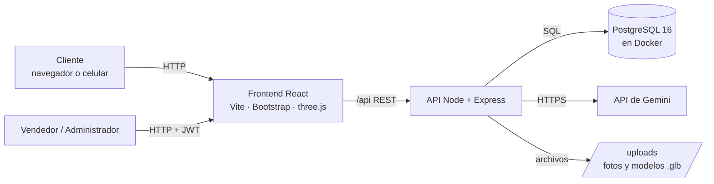
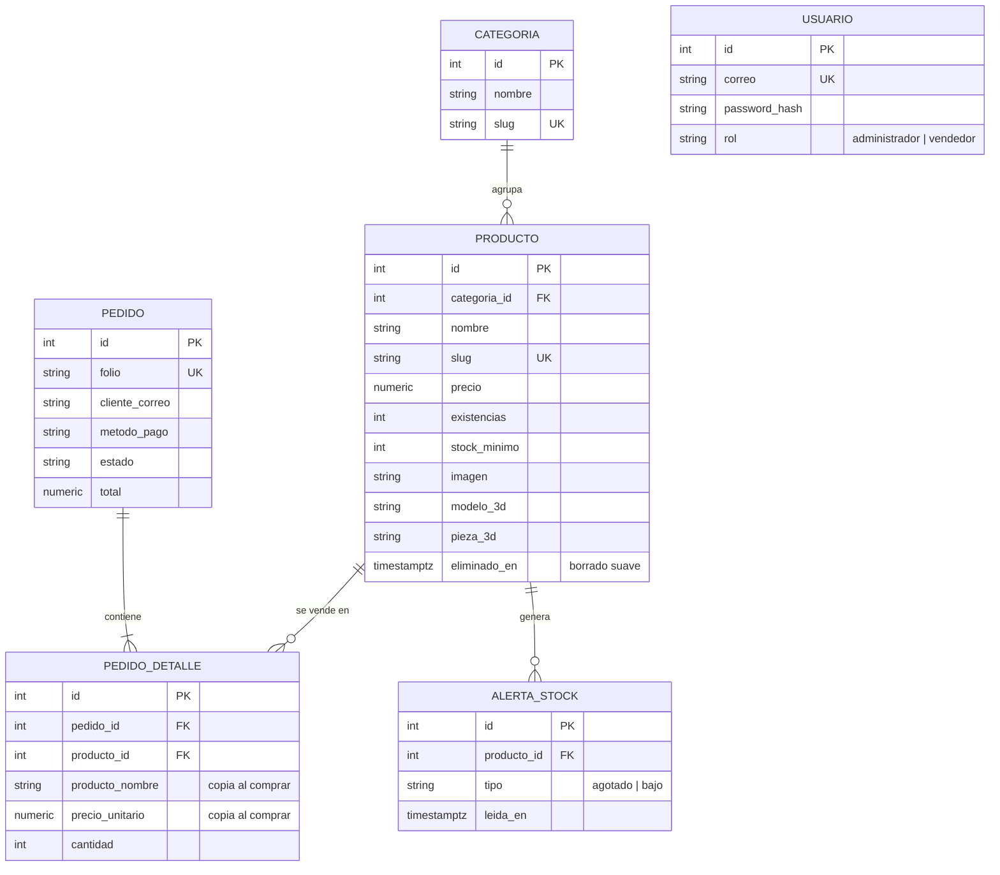
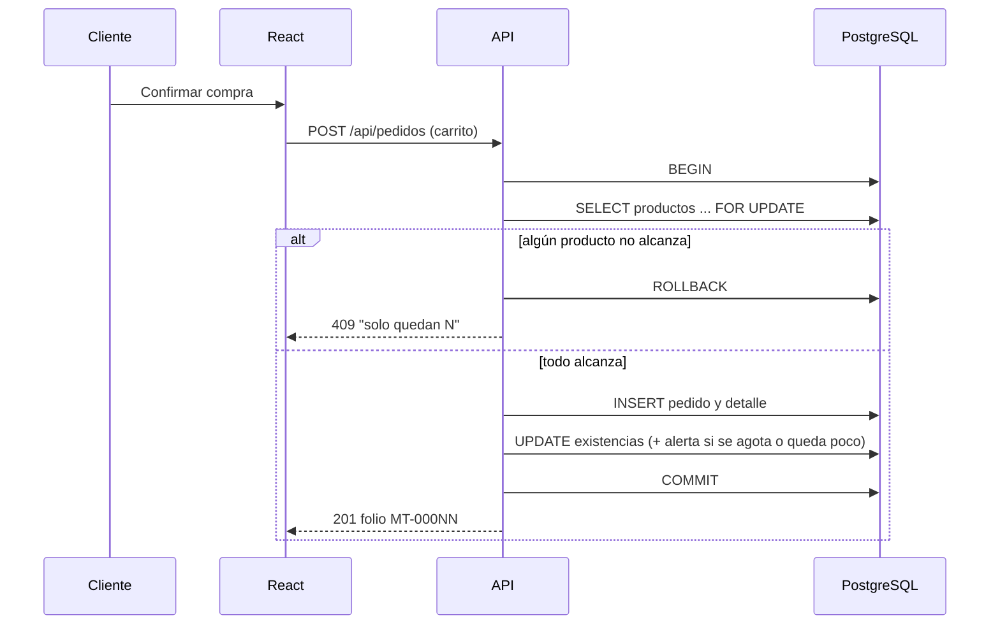

# Arquitectura

## Vista general

| Capa | Tecnología | Carpeta |
|---|---|---|
| Interfaz | React 19, React Router, Bootstrap 5, three.js para la escena 3D, `<model-viewer>` para realidad aumentada | `client/` |
| API | Node.js 20+, Express 5, JWT para sesiones, bcrypt para contraseñas, multer para subir archivos | `server/` |
| Datos | PostgreSQL 16 en Docker | `database/` |
| IA | API de Gemini (`generateContent`) | `server/src/services/gemini.js` |

## Modelo de datos

## Flujo de compra (todo o nada)

`FOR UPDATE` bloquea las filas de los productos mientras dura la compra, así dos clientes no pueden comprar la última pieza al mismo tiempo.

## Decisiones importantes

| Decisión | Por qué |
|---|---|
| Las existencias solo cambian en `services/stock.js` | Así siempre se genera la alerta de agotado o de stock bajo, venga el cambio de una compra, del panel, de una cancelación o del importador |
| El detalle del pedido guarda nombre y precio | Si después cambia el precio o se elimina el producto, el pedido viejo sigue diciendo lo que se cobró |
| Borrado suave de productos | Eliminar no rompe pedidos anteriores |
| Carrito en el navegador | No requiere cuenta para comprar; el servidor vuelve a validar existencias al pagar |
| Seguimiento pide folio y correo, por POST | Nadie puede ver pedidos ajenos adivinando folios, y el correo no queda en la URL ni en el historial |
| IA con respaldo | Si no hay llave o Gemini falla, el asesor sigue funcionando con reglas; las herramientas del panel explican qué falta |
| three.js y el panel se cargan aparte | La tienda abre con 284 kB en lugar de 836 kB |

## Seguridad

- Contraseñas con bcrypt; sesiones con JWT que expiran a las 8 horas.
- Permisos revisados en el servidor, no solo escondiendo botones: el vendedor recibe 403 si intenta acciones de administrador.
- Consultas SQL siempre con parámetros (`$1`, `$2`), nunca concatenando texto del usuario.
- Archivos subidos: solo imágenes (JPG, PNG, WEBP, GIF), `.glb` y PDF, con límite de tamaño y nombres aleatorios.
- Límite de consultas al asesor y al seguimiento por minuto.
- Las llaves y contraseñas viven en `.env`, que Git ignora.
