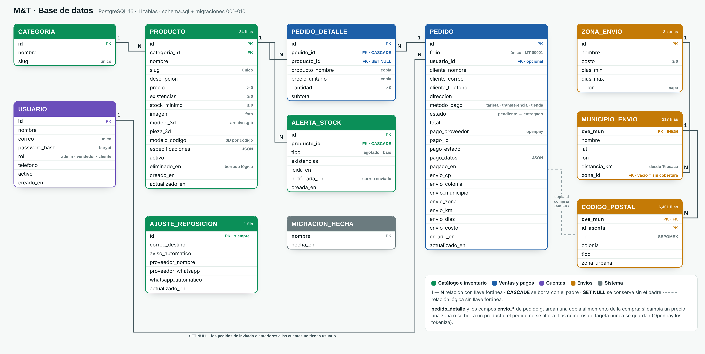
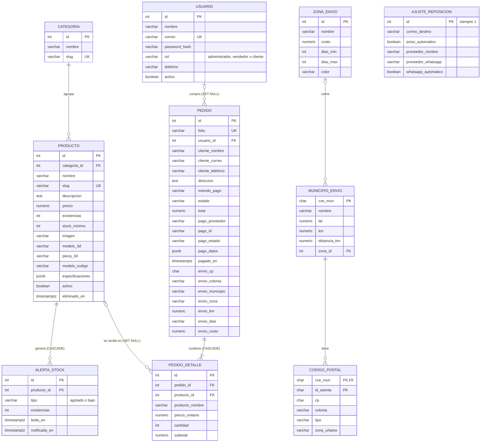

# Diagramas

| Diagrama | Archivo |
|---|---|
| Flujo de compra del cliente | [flujo-compra.png](flujo-compra.png) |
| Flujo del panel (administrador y vendedor) | [flujo-panel.png](flujo-panel.png) |
| Base de datos (entidad-relación) | [base-de-datos.png](base-de-datos.png) |

Se generan con los scripts de `fuente/` (Python + Playwright) a partir del código real:

```bash
pip install playwright && playwright install chromium
cd docs/diagramas && python fuente/flujos.py && python fuente/base_de_datos.py
```

Si cambia una tabla en `database/schema.sql` o un paso del proceso, actualiza el script y vuelve a generar la imagen.

## Base de datos



PostgreSQL 16 con 11 tablas: `database/schema.sql` más las migraciones `database/migraciones/001` a `010`, que el servidor aplica solo al arrancar.

| Módulo | Tablas |
|---|---|
| Catálogo e inventario | `categoria`, `producto`, `alerta_stock`, `ajuste_reposicion` |
| Ventas y pagos | `pedido`, `pedido_detalle` |
| Cuentas | `usuario` (administrador, vendedor y cliente) |
| Envíos | `zona_envio`, `municipio_envio`, `codigo_postal` |
| Sistema | `migracion_hecha` (migraciones que corren una sola vez) |

La misma estructura en Mermaid (GitHub la dibuja sola):



`pedido_detalle` y los campos `envio_*` de `pedido` copian los datos al momento de la compra (nombre, precio, CP, zona y costo). Así, si después cambia un precio o una zona, o se borra un producto, el pedido no se altera.
