# Manual de usuario

## Para el cliente

### 1. Ver la PC en 3D

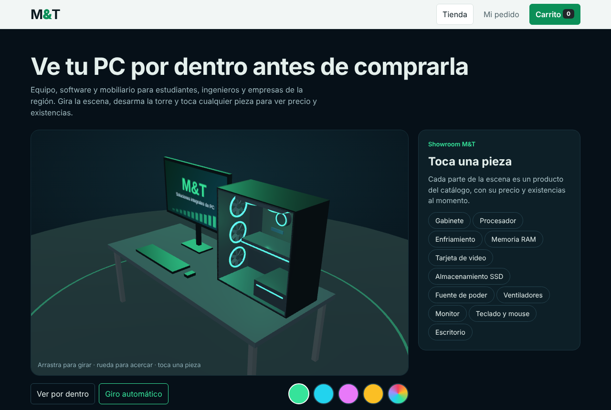

- Arrastra con el mouse (o el dedo) para girar la escena; usa la rueda para acercar.
- Toca cualquier pieza para ver su nombre, precio y existencias a la derecha.
- Los círculos de color cambian la iluminación RGB de la PC.

### 2. Ver la PC por dentro

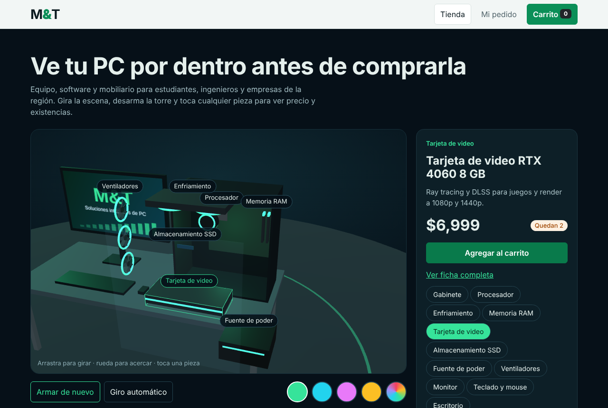

**Ver por dentro** separa las piezas de la torre y les pone nombre. Desde la ficha de la derecha puedes agregar la pieza al carrito o abrir su ficha completa. **Armar de nuevo** regresa la torre a su forma original.

### 3. Catálogo

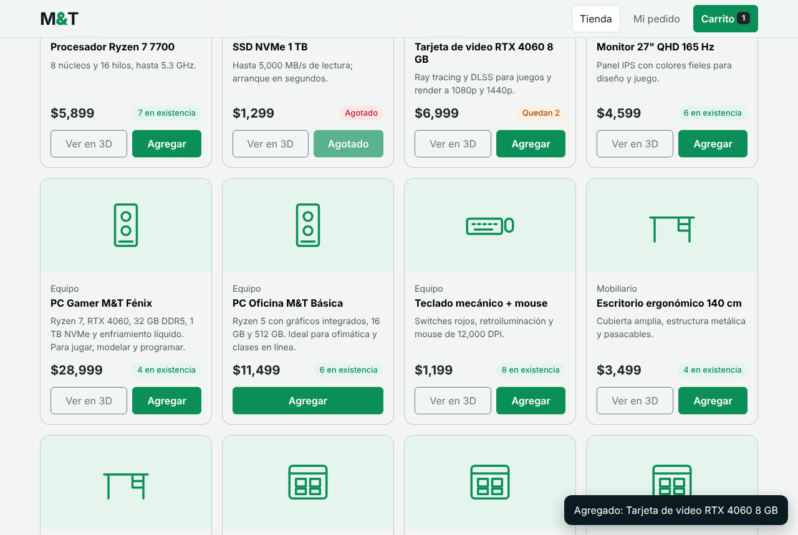

Filtra por categoría o busca por nombre. Cada producto muestra si hay existencias, si quedan pocas o si está agotado. **Ver en 3D** te lleva a esa pieza en la escena.

### 4. Asesor M&T

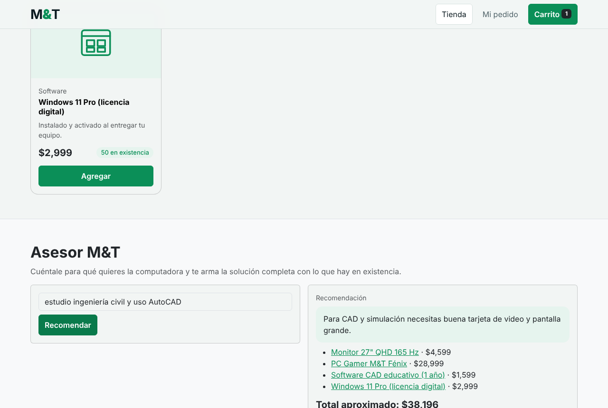

Escribe para qué quieres la computadora (por ejemplo "estudio ingeniería civil y uso AutoCAD"). El asesor arma una solución completa con productos en existencia y la puedes agregar al carrito con un clic.

### 5. Carrito y pago

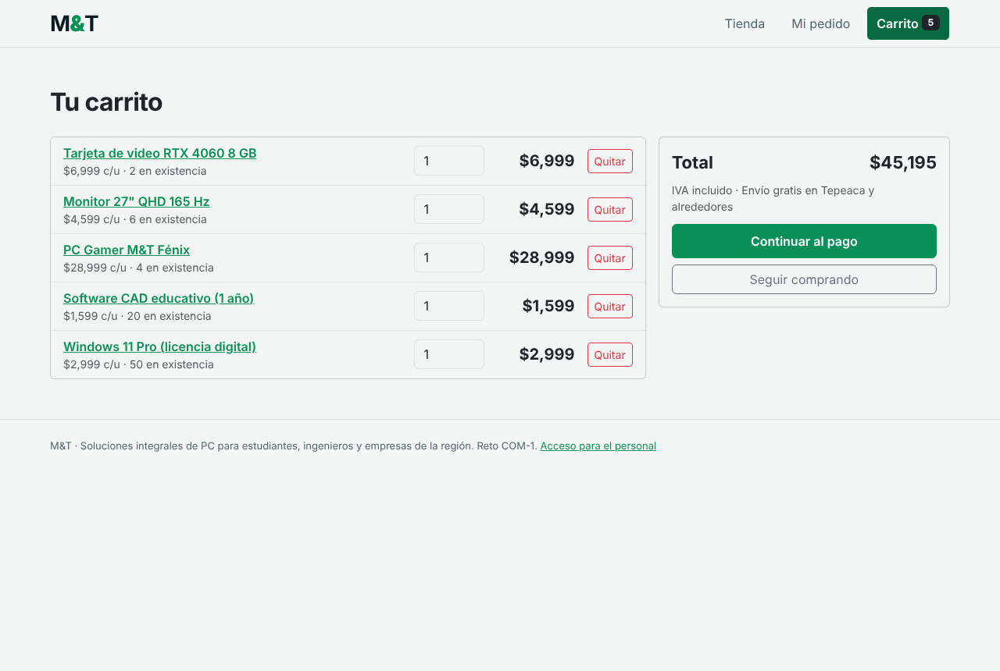

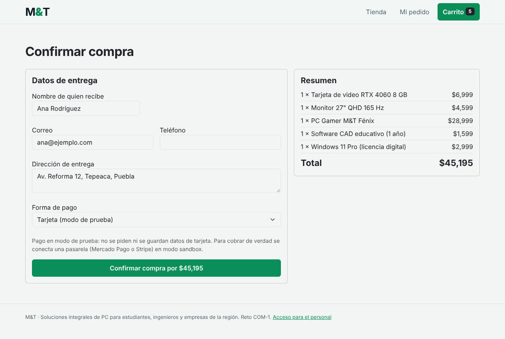

Ajusta cantidades, quita productos y confirma la compra con tus datos de entrega. El pago es de prueba: no se piden datos de tarjeta.

### 6. Folio y seguimiento

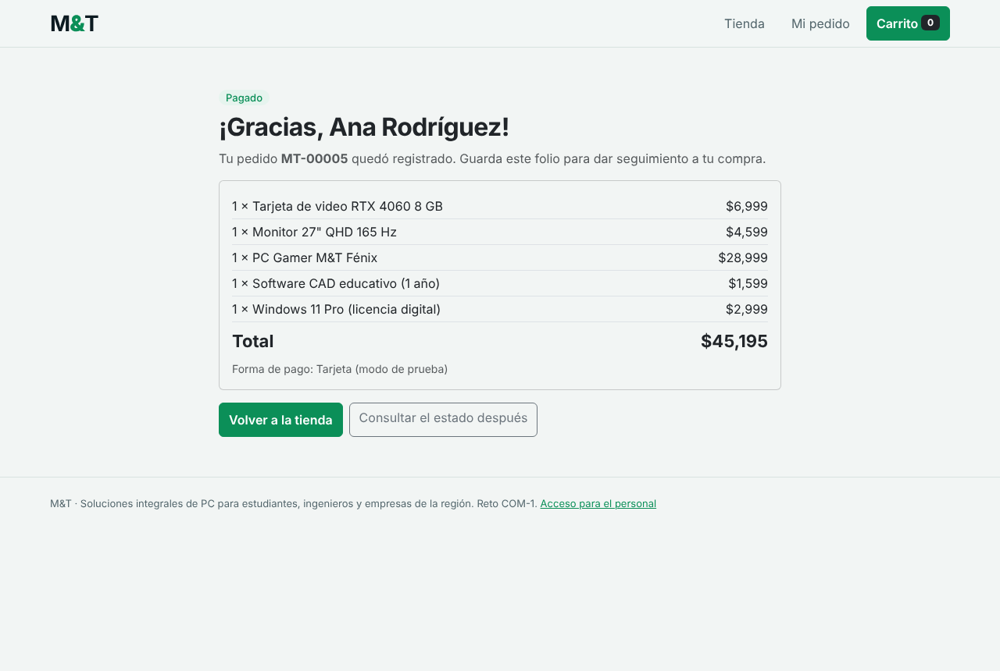

Al comprar recibes un folio (por ejemplo `MT-00005`). En **Mi pedido** escribes el folio y tu correo para ver en qué paso va tu pedido.

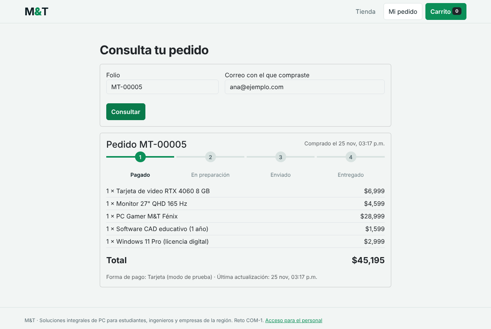

## Para el personal de la tienda

### Entrar al panel

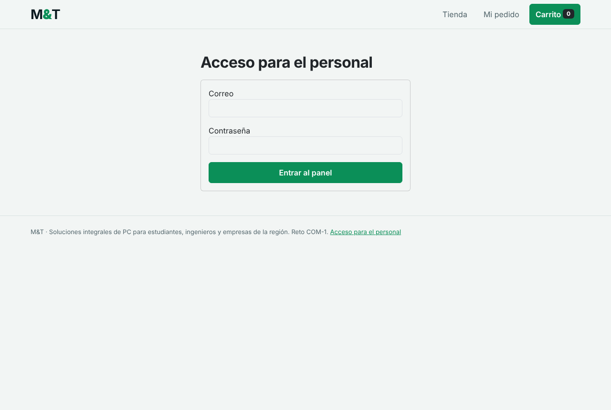

Da clic en **Iniciar sesión** (arriba a la derecha) y entra con tu cuenta del equipo: el mismo inicio de sesión de los clientes te lleva directo al panel.

| Rol | Puede |
|---|---|
| Administrador | Todo |
| Vendedor | Resumen, existencias y pedidos (no da de alta, edita ni elimina productos) |

### Resumen

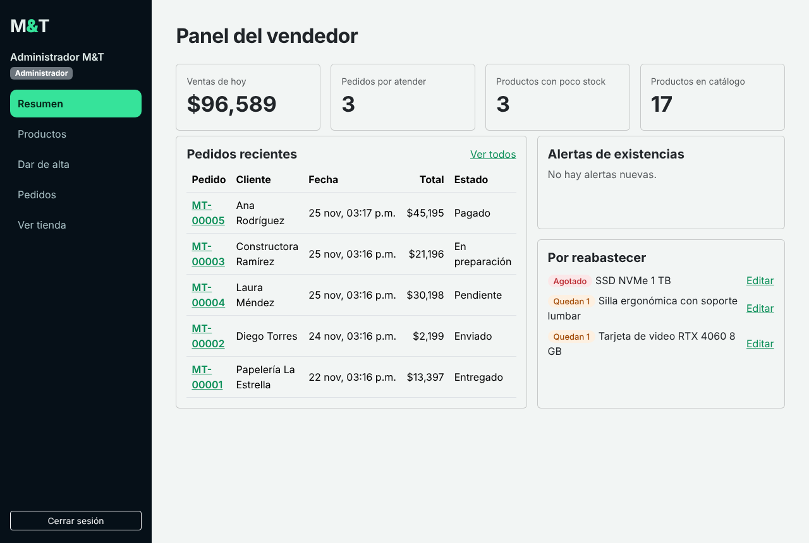

- Ventas del día, pedidos por atender y productos con poco stock.
- **Alertas de existencias:** aparecen solas cuando un producto se agota o baja del mínimo. Márcalas como leídas cuando ya las atendiste.
- **Por reabastecer:** lista de productos en o por debajo de su mínimo.

### Productos

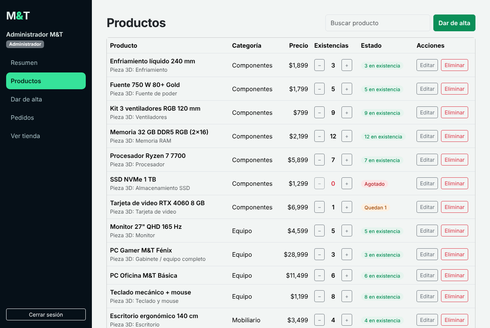

- Los botones **−** y **+** ajustan existencias al momento.
- **Editar** y **Eliminar** son solo para el administrador. Eliminar oculta el producto, pero los pedidos anteriores lo conservan.

### Dar de alta o editar un producto

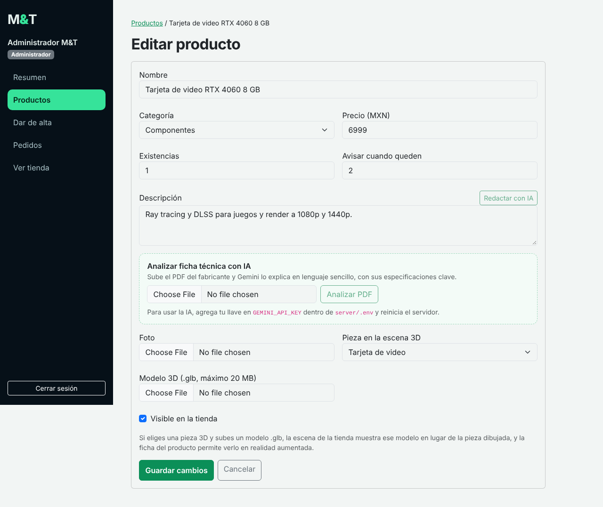

- **Avisar cuando queden:** con cuántas piezas se genera la alerta de stock bajo.
- **Redactar con IA:** Gemini escribe la descripción usando el nombre y lo que ya escribiste.
- **Analizar ficha técnica con IA:** sube el PDF del fabricante y Gemini lo explica en lenguaje sencillo con sus especificaciones clave. **Usar como descripción** la copia al campo de descripción.
- **Pieza en la escena 3D** y **Modelo 3D (.glb):** si eliges una pieza y subes su modelo, la escena de la tienda lo muestra en lugar de la pieza dibujada, y la ficha del producto permite verlo en realidad aumentada desde el celular.

### Pedidos

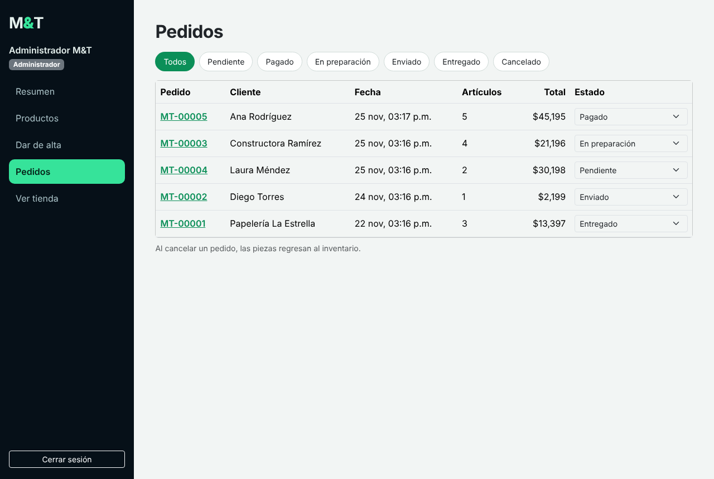

Filtra por estado y cambia el estado desde la lista o desde el detalle del pedido.

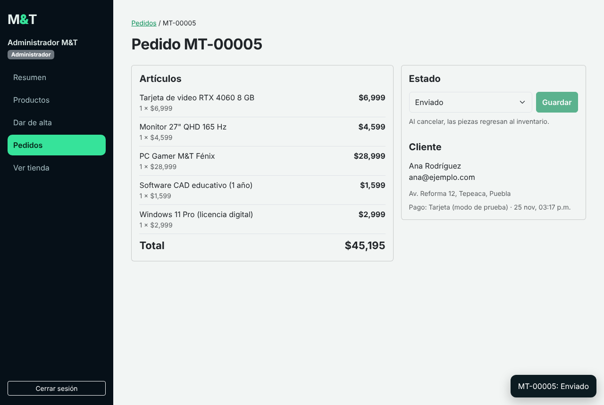

Al **cancelar** un pedido, sus piezas regresan al inventario. Un pedido cancelado ya no se puede reactivar.

## En el celular

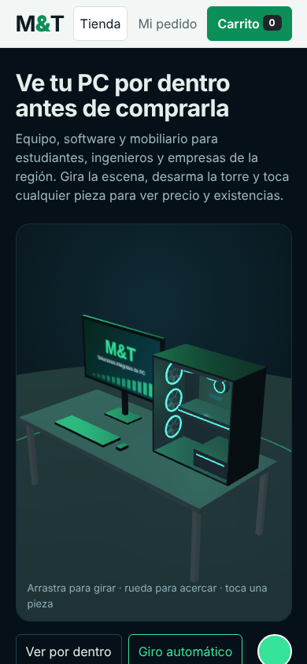

Toda la tienda y el panel se adaptan a pantallas pequeñas.
